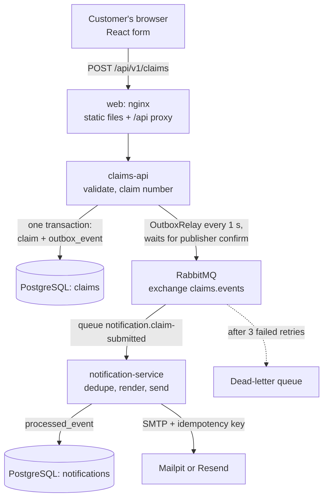

# Home Insurance Claim Submission Portal

A customer submits a home insurance claim online, gets a claim number straight away, and receives a confirmation email containing that number. The email is generated and sent by a separate service that consumes a `ClaimSubmitted` event from a message queue.

| Part | Technology |
| --- | --- |
| Web app | React 19 + TypeScript (Vite), served by nginx |
| Claims API | Java 21, Spring Boot 4.1, Spring Data JPA, Flyway |
| Notification service | Java 21, Spring Boot 4.1, Spring AMQP, Spring Mail, Thymeleaf |
| Messaging | RabbitMQ 3.13 |
| Database | PostgreSQL 16 (one database per service) |
| Email | Mailpit (local capture, default) or Resend free tier (real delivery) |
| Tests | JUnit 5, Mockito, Testcontainers, Vitest, React Testing Library |

---

## Quick start

**Prerequisites**

| To | You need |
| --- | --- |
| Run and demo the app | Docker with Docker Compose v2. Nothing else; every supporting service (PostgreSQL, RabbitMQ, Mailpit, Prometheus, Grafana) runs in Compose at no cost |
| Run the tests or the services outside Docker | Java 21, Maven 3.9+, Node.js 22, and Docker running (Testcontainers starts PostgreSQL, RabbitMQ and Mailpit for the integration tests) |
| Send real email (optional) | A free Resend account and API key, see below |

```bash
cp .env.example .env          # local-only credentials; .env is git-ignored
docker compose up --build
```

| Open | URL |
| --- | --- |
| Claim form | http://localhost:8080 |
| Captured emails (Mailpit) | http://localhost:8025 |
| RabbitMQ console | http://localhost:15672 (user and password from `.env`) |
| Claims API health | http://localhost:8081/actuator/health |
| Claims API metrics (Prometheus format) | http://localhost:8081/actuator/prometheus |
| Grafana dashboard | http://localhost:3000 (view without signing in; `admin` and `GRAFANA_ADMIN_PASSWORD` from `.env` to edit) |
| Prometheus | http://localhost:9090 |

The first build downloads Maven and npm dependencies and takes a few minutes. Every service has a health check, and Compose starts each one only when its dependencies are healthy.

### Changing database passwords

Postgres creates the `claims` and `notifications` users only when the `postgres-data` volume is first created ([infra/postgres/init-databases.sh](infra/postgres/init-databases.sh)). After that, editing `CLAIMS_DB_PASSWORD` or `NOTIFICATIONS_DB_PASSWORD` in `.env` does not change the passwords stored in the database, and the services fail on startup with `password authentication failed`. Either:

- **Reset the database** (deletes all stored claims): `docker compose down -v && docker compose up --build`
- **Or update the password in place**, keeping the data:

  ```bash
  docker compose up -d postgres   # picks up the new .env values
  echo "ALTER USER claims PASSWORD :'pw';" \
    | docker compose exec -T postgres sh -c 'psql -U postgres -v pw="$CLAIMS_DB_PASSWORD"'
  docker compose restart claims-api
  ```

  For the notification service, use `notifications`, `$NOTIFICATIONS_DB_PASSWORD` and `notification-service` instead.

### Sending real email with Resend (optional)

Mailpit catches every email locally, so no account is needed. To deliver real email with duplicate protection:

1. Create a free account at [resend.com](https://resend.com) and an API key with "Sending access".
2. In `.env`, set `EMAIL_PROVIDER=resend` and `RESEND_API_KEY=<your key>`.
3. `docker compose up -d notification-service`

Without a verified domain, Resend only delivers to the email address on your Resend account, so use that address in the claim form. The free tier allows 100 emails a day.

---

## Demo walkthrough

1. Open http://localhost:8080 and press **Submit claim** on the empty form. You'll see field-level errors and an error summary that receives focus.
2. Fill the form in and submit. The confirmation page shows a claim number such as `CLM-7K4Q-9XHM`.
3. Open Mailpit at http://localhost:8025. The confirmation email with the same claim number arrives within about a second.
4. Trace one claim across both services by correlation id:
   ```bash
   docker compose logs claims-api notification-service | grep <correlation id from the response header>
   ```
5. **Resilience demo: the broker goes down.**
   ```bash
   docker compose stop rabbitmq
   # submit another claim in the browser: it is still accepted (201)
   docker compose start rabbitmq
   # within seconds the outbox relay publishes it and the email arrives
   ```
   On the Grafana dashboard (http://localhost:3000), **Outbox pending** rises while the broker is down, failed publish attempts appear, and the backlog drains to 0 when it returns.

Submitting with curl:

```bash
curl -i http://localhost:8080/api/v1/claims -H 'Content-Type: application/json' -d '{
  "firstName": "Dana", "lastName": "Smith", "email": "dana@example.com", "phone": "204-555-0142",
  "policyNumber": "HO-12345678", "lossDate": "2026-10-20", "lossType": "SEWER_BACKUP",
  "address": {"line1": "123 Main St", "city": "Winnipeg", "province": "MB", "postalCode": "R3C 1A1"},
  "description": "Basement flooded after heavy rain; carpet and drywall damaged."
}'
```

The loss date must be within the past year.

---

## Architecture



The customer's request ends when claims-api commits the claim and its outbox row together. Everything after that is asynchronous, and only notification-service sends email.

### Components

**claims-api** (`claims-api/`)

| Layer | Classes | Responsibility |
| --- | --- | --- |
| web | `ClaimController`, `SubmitClaimRequest`, `GlobalExceptionHandler` | HTTP, Bean Validation, RFC 9457 problem-details errors |
| application | `ClaimSubmissionService` | One transaction: claim number, save claim, write outbox row |
| domain | `Claim`, `Address`, `ClaimNumberGenerator`, `RandomClaimNumberGenerator` | The claim and how it is numbered |
| outbox | `OutboxWriter`, `OutboxRelay`, `OutboxPoller`, `EventPublisher`, `RabbitEventPublisher`, `OutboxCleanup` | Transactional outbox, broker publishing, nightly cleanup |
| observability | `CorrelationIdFilter` | Correlation id on every log line and response |

**notification-service** (`notification-service/`)

| Layer | Classes | Responsibility |
| --- | --- | --- |
| messaging | `ClaimSubmittedListener` | Broker message to service call; rejects unreadable messages |
| application | `ClaimNotificationService` | Idempotency check, then compose and send |
| email | `EmailComposer`, `EmailSender`, `SmtpEmailSender` | Thymeleaf rendering and SMTP delivery |
| persistence | `ProcessedEventRepository`, `ProcessedEventCleanup` | `INSERT ... ON CONFLICT DO NOTHING` dedupe; nightly cleanup |
| config | `RabbitTopologyConfig`, `RetryConfig` | Queue, DLQ, retry policy |

**web** (`web/`): `ClaimForm`, `Confirmation`, `validation.ts` (mirrors the server rules), `api.ts` (maps server errors back onto fields).

The interfaces `ClaimNumberGenerator`, `EventPublisher` and `EmailSender` are the seams for unit tests and for swapping infrastructure (for example SQS instead of RabbitMQ, or SES instead of SMTP) without touching business logic.

### Data model

| Database | Table | Purpose |
| --- | --- | --- |
| `claims` | `claim` | The submitted claim. `claim_number` and the optional `idempotency_key` have unique constraints |
| `claims` | `outbox_event` | Events waiting to be published. `published_at IS NULL` means unsent (partial index). Published rows are deleted after 7 days |
| `notifications` | `processed_event` | One row per emailed event. The primary key on `event_id` makes the consumer idempotent. Rows are deleted after 30 days, well past any redelivery |

Migrations live in each service's `src/main/resources/db/migration` and run on startup (Flyway). Each service has its own database user and cannot connect to the other's database.

### Event contract

`ClaimSubmitted` v1 is defined by [`contracts/claim-submitted.v1.json`](contracts/claim-submitted.v1.json). Each service owns its own Java type, and both test against the fixture. It carries only what the email needs (claim number, first name, email), so the address, policy number and damage description never travel over the broker.

---

## How the engineering criteria are met

| Criterion | Where to look |
| --- | --- |
| **Separation of concerns** | Five parts with one job each: the React UI (`web/`) only collects and checks input; `claims-api` validates, numbers and saves the claim; the outbox relay (`claims-api/.../outbox`) is the only code that publishes events; `notification-service`'s listener is the only consumer; its email package is the only code that sends email. The services share no code or database, only the event contract in `contracts/` |
| **Layering and dependency injection** | Each service is layered web or messaging, then application, then domain or persistence (tables above). Dependencies point inwards: controllers map DTOs to application records (`NewClaim`, `SubmittedClaim`), and the application layer never sees HTTP or AMQP types. Every collaborator is constructor-injected, including `Clock` and `TransactionOperations`, so time and transactions are controllable in tests |
| **Design patterns** | Transactional outbox and idempotent consumer (the core of the design); repository (Spring Data, `ProcessedEventRepository`); strategy behind interfaces (`ClaimNumberGenerator`, `EventPublisher`, `EmailSender`); builder (`Claim.builder()`); template rendering (Thymeleaf email); problem details for errors (RFC 9457) |
| **SOLID** | Single responsibility: composing an email (`EmailComposer`) is separate from sending it (`SmtpEmailSender`), and polling (`OutboxPoller`) is separate from publishing (`OutboxRelay`). Open/closed and dependency inversion: business code depends on the three interfaces above, so RabbitMQ could become SQS, or SMTP could become an HTTP API, without touching it. Interface segregation: each interface has one method |
| **Automated unit testing** | A test pyramid: fast unit tests with mocks for every rule and branch (validation, numbering, relay batching, dedupe, retries, error mapping), integration tests against real PostgreSQL, RabbitMQ and Mailpit through Testcontainers for the guarantees mocks cannot prove (rollback, publisher confirms, one email per event), contract tests on both sides of the event, and Playwright end to end. All run in CI on every pull request (see [Testing](#testing)) |
| **Input validation** | Bean Validation on the request DTO plus a custom `@ValidLossDate`; the browser mirrors the same rules in `validation.ts` for convenience only. The consumer rejects unreadable or incomplete events straight to the DLQ |
| **Error handling** | `GlobalExceptionHandler` returns RFC 9457 problem details with a correlation id and never a stack trace. Broker outages are absorbed by the outbox; email outages by retries with backoff, then the DLQ (see [Failure handling](#failure-handling)) |
| **Configuration management** | All settings live in each service's `application.yml` and are overridden by environment variables; typed `@ConfigurationProperties` records for grouped settings; Spring profiles for the email provider (`resend`); credentials have no defaults and come only from `.env` |
| **Logging** | One line per business event (claim submitted, email sent, duplicate skipped, publish failure) with the correlation id on every line via MDC, passed from the HTTP request through the event to the consumer. No personal information is logged (see [Security](#security)) |
| **Containerization** | Multi-stage Dockerfiles, every app container runs as a non-root user, health checks on every service, and one `docker compose up --build` for the whole stack |
| **Security** | See [Security](#security): no secrets in the repo, minimal personal information on the broker and none in logs, escaping, security headers, least-privilege database users |
| **Pragmatism** | Choices sized to the exercise: a JPA entity as the domain model, a polling relay instead of change data capture, one Postgres container hosting both databases, anonymous submission. Each is listed with what production would need in [What is production-ready and what is not](#what-is-production-ready-and-what-is-not) |

## Key design decisions and trade-offs

### 1. Transactional outbox (the main trade-off)

**Problem:** saving the claim and publishing the event are writes to two systems that cannot commit together. If the save succeeds and the publish fails, the customer is told to expect an email that never comes.

**Decision:** `ClaimSubmissionService` writes the claim and an `outbox_event` row in the **same database transaction**. `OutboxRelay` publishes unsent rows every second, waits for RabbitMQ's publisher confirm, then sets `published_at`. `OutboxWriter` uses `Propagation.MANDATORY`, so it fails fast if anyone calls it outside a transaction.

**Alternatives considered:**

- Publish after commit (`@TransactionalEventListener`): simpler, but a crash or broker outage loses the event silently.
- Publish inside the transaction: worse, because it can announce a claim that then rolls back.
- Change data capture (Debezium): the production-grade relay, but too much infrastructure for this scope.

**Cost:** delivery is at-least-once (a crash after the confirm but before `published_at` is saved republishes the event), plus up to about 1 second of latency. The consumer handles duplicates, below.

### 2. Preventing duplicate emails

Exactly-once delivery across a database and a mail provider is not achievable, because SMTP cannot take part in a transaction. Two layers handle it:

1. **Consumer idempotency.** `processed_event` is inserted with `ON CONFLICT DO NOTHING` in the same transaction as the send. A duplicate event finds the row and is skipped. If the send fails, the transaction rolls back and the broker redelivers.
2. **Provider idempotency.** The one remaining gap is a crash after the provider accepted the email but before the commit. Every email carries `Resend-Idempotency-Key: <eventId>`, and Resend returns the original result for a repeated key within 24 hours instead of sending again. The email body is deterministic (no timestamps), as Resend requires. A stable `Message-ID` built from the event id is a final hint to mail clients.

With Mailpit (local), layer 2 is not available, so that narrow crash window could produce a duplicate.

The same thinking applies one step earlier, to the customer's request. If the network drops after the claim is saved but before the browser gets the response, the customer sees an error and presses Submit again. The form therefore sends an `Idempotency-Key` header, one random UUID per claim being reported, reused on every retry. A repeated key returns the original claim with the same 201 body, so there is no second claim and no second email. Two concurrent requests with the same key are settled by the unique index: the loser catches the violation and returns the winner's claim. The header is optional, so other API clients still work without it.

### 3. Other decisions

| Decision | Why | Trade-off |
| --- | --- | --- |
| RabbitMQ | Queue semantics, dead-lettering built in, first-class Spring support | No event replay like Kafka; not needed here |
| Random claim number `CLM-XXXX-XXXX` (30-character alphabet without 0/O/1/I/L/U) | Not guessable, easy to read over the phone, about 6.5 x 10^11 combinations | Needs a uniqueness check; a collision triggers a retry (up to 3) |
| Minimal event payload | Less personal information on the broker; consumer needs no callback to claims-api | Adding email content needs a contract change |
| Separate database per service | Services stay independently deployable | Two databases to run (one Postgres container hosts both locally) |
| Per-service event DTO plus shared JSON fixture | No shared jar coupling release cycles | Duplicate type definitions, kept honest by contract tests |
| nginx proxies `/api` | One origin for the browser, so no CORS configuration | nginx config to maintain |
| JPA entity doubles as domain model | Little behaviour to protect at this size | Would split as the claim lifecycle grows |

---

## Failure handling

| Failure | What happens | Customer impact |
| --- | --- | --- |
| Invalid input | 400 problem details with an error per field; nothing saved | Fixes the highlighted fields |
| Database down | 500 with a correlation id; nothing saved | Sees "try again" and a reference, never a false confirmation |
| RabbitMQ down | Claim and outbox row saved; relay retries every second and records `attempts` and `last_error` | Confirmation shown; email arrives once the broker recovers |
| Crash after publish, before `published_at` | Event republished | None: consumer skips the duplicate |
| SMTP or Resend down | 3 retries with backoff (1 s, 2 s, 4 s), then dead-letter queue; event not marked processed | Email delayed until the DLQ message is replayed |
| Unreadable message | Straight to the DLQ, no retries | Needs investigation |
| Two copies of the same event at once | Second waits on the first's row lock, then skips | One email |

---

## Testing

```bash
mvn verify                 # all Java tests; needs Docker running for Testcontainers
cd web && npm ci && npm test

# End-to-end, against the running Compose stack. Needs EMAIL_PROVIDER=mailpit:
# the email test reads Mailpit, and Resend rejects the test's @example.com addresses.
docker compose up --build --detach --wait
cd e2e && npm ci && npx playwright install chromium && npx playwright test
```

| Suite | Count | Highlights |
| --- | --- | --- |
| claims-api | 46 | Claim and outbox commit or roll back together, against real PostgreSQL; relay publishes to real RabbitMQ with the event id as message id; batched publish and backlog draining; a retried submission with the same idempotency key creates one claim and one event; validation and error shape; claim number format and collision retry; outbox cleanup |
| notification-service | 20 | Same event delivered twice sends one email (real RabbitMQ, PostgreSQL and Mailpit); SMTP outage leads to DLQ without marking processed; malformed message goes to the DLQ unretried; HTML escaping; idempotency headers; processed-event cleanup |
| web | 27 | Field rules mirror the server; error summary and accessible descriptions; required fields announced to screen readers; server errors mapped to fields; confirmation shows the claim number; a retry reuses the idempotency key; a rate-limited submission tells the customer to wait |
| e2e (Playwright) | 6 | Real browser against the full Compose stack: submit the form, see the claim number, and find exactly one email with that number in Mailpit; incomplete form stopped in the browser; API rejects invalid data on its own; Prometheus scrapes both services, every Grafana panel query returns data, and the dashboard is provisioned |

The most important tests to discuss:

1. `ClaimSubmissionIntegrationTest.claimIsRolledBackWhenTheOutboxInsertFails`: the database rejects the outbox row, and the claim row in the same transaction is rolled back. This is the outbox guarantee, proven against a real database without mocks.
2. `NotificationIntegrationTest.theSameEventDeliveredTwiceSendsOnlyOneEmail`: idempotent consumer, end to end.
3. `SmtpOutageIntegrationTest`: retries, dead-lettering, and no "processed" mark left behind, so a replay still sends.
4. The two `ClaimSubmittedContractTest` classes: producer and consumer agree on the event shape.

CI (`.github/workflows/ci.yml`) runs the backend tests, the frontend typecheck, tests and build, builds all container images, and runs the end-to-end suite against the full stack started with Docker Compose.

### Metrics

Both services expose `/actuator/prometheus`, with the standard JVM, HTTP, database pool and RabbitMQ metrics plus these business metrics:

| Metric | Service | What it tells you |
| --- | --- | --- |
| `claims_submitted_total` | claims-api | Claims saved, counted after the transaction commits |
| `outbox_pending` | claims-api | Events waiting for the broker. Steady growth means RabbitMQ is unreachable |
| `outbox_published_total`, `outbox_publish_failures_total` | claims-api | Relay throughput and failed publish attempts |
| `notification_emails_total{outcome="sent"\|"duplicate_skipped"}` | notification-service | Emails sent, and redelivered events the idempotency check stopped |

The Compose stack includes Prometheus, which scrapes both services every 5 seconds ([infra/prometheus/prometheus.yml](infra/prometheus/prometheus.yml)), and Grafana with a pre-built **Claim Portal** dashboard ([infra/grafana/](infra/grafana/)): services up, outbox backlog, relay throughput and failures, API responses by status, and confirmation emails by outcome. Open it at http://localhost:3000.

To read the raw endpoints: the claims API's is published on port 8081. The notification service's port is internal to Compose, so read it with `docker compose exec notification-service wget -qO- localhost:8082/actuator/prometheus`.

---

## Security

- **Secrets:** no credentials in the repo. Compose reads them from a git-ignored `.env`, and the apps have no default passwords. The Resend API key is only ever an environment variable.
- **Personal information:** logs contain claim numbers and event ids, never names, emails or addresses. An unreadable event is logged by error type only, because parser messages can quote field values. The event payload carries only what the email needs.
- **Input:** all rules are enforced server-side with length limits; the browser checks are only for convenience. nginx caps request bodies at 64 KB.
- **Output:** Thymeleaf HTML-escapes customer input in the email (there is a test with `<script>`). The API never returns stack traces or exception messages.
- **Log injection:** an incoming `X-Correlation-Id` is accepted only if it matches `[A-Za-z0-9-]{1,64}`.
- **Headers:** nginx sets `Content-Security-Policy` (including `base-uri`, `form-action` and `object-src`), `X-Frame-Options`, `X-Content-Type-Options` and `Referrer-Policy`, and hides its version.
- **Abuse:** nginx limits claim submissions to 10 a minute per client IP, with a burst of 10, and returns 429, which the form explains. It's a per-IP limit only; a determined bot needs CAPTCHA or verification (see production gaps).
- **Network exposure:** every host port in Compose binds to `127.0.0.1`, so Mailpit (which shows customer emails), the API, the RabbitMQ console and the monitoring tools can't be reached from other machines.
- **Least privilege:** each service has its own database user and database. The JVM services run as a non-root user, and nginx uses the unprivileged image.
- **Monitoring endpoints:** `/actuator/prometheus`, Prometheus and Grafana's anonymous read-only view have no authentication. That suits a local demo only; production would serve actuator on a separate management port and put the monitoring tools behind single sign-on.

---

## Assumptions

- **Anonymous submission.** There is no login, so anyone could file against any policy number (see production gaps).
- **Policy number format** is assumed to be `HO-` followed by 8 digits. There is no policy system to verify against.
- **Loss date** must be today or within the past year, using the Winnipeg calendar day.
- **Canadian addresses only**, with postal code format checks. Not limited to Manitoba.
- **Loss types** are a fixed list including Manitoba-relevant perils (sewer backup, overland flood, wind and hail).
- **English only.**
- **The confirmation page shows the claim number** as well as pointing to the email, in case the email is delayed.

## Out of scope

Authentication and customer accounts, policy verification, photo upload, anything after submission (adjuster assignment, status lookup, back office), broker notifications, French localization, paid email or cloud services, fraud checks.

---

## What is production-ready and what is not

| Area | In this MVP | For production |
| --- | --- | --- |
| Reliability | Outbox, publisher confirms, idempotent consumer, idempotent submission, retries, DLQ, cleanup of old outbox and processed-event rows | DLQ alerting and a replay tool |
| Security | Validation, escaping, secrets in env, least-privilege DB users, per-IP rate limit on submissions, host ports on localhost only, non-root containers | Authentication or policy-holder verification, CAPTCHA, secrets manager, TLS everywhere with HSTS, dependency and image scanning in CI |
| Observability | Health checks, correlation ids across services, Prometheus metrics with a Grafana dashboard (below) | Alerting rules and on-call routing, DLQ depth from RabbitMQ, tracing (OpenTelemetry), JSON logs to a central store |
| Scale | Stateless API; relay uses `SKIP LOCKED` so several instances share the outbox, publishes each batch with one broker confirm and keeps draining while batches come back full; 4 to 8 concurrent consumers per notification instance (`LISTENER_CONCURRENCY`) | Load testing; quorum queues and a RabbitMQ cluster; database read replicas and connection pooling (PgBouncer); partition or CDC-based relay at very high volume; a paid email plan (Resend's free tier caps daily volume) |
| Data | Flyway migrations | Retention policy for claim PII, backups, encryption at rest |

## With more time

1. Verify the policy number against a policy system, and confirm the policy holder's identity (for example postal code plus last name).
2. Photo and document upload to object storage with virus scanning.
3. Claim status lookup page, which is where the non-guessable claim number pays off.
4. DLQ replay endpoint, and alerts on DLQ depth and on the `outbox_pending` metric.
5. OpenTelemetry tracing through HTTP and AMQP headers.
6. French translation.

---

## Project layout

```
claims-api/              Spring Boot service: submission, outbox, relay
notification-service/    Spring Boot service: consumer, idempotency, email
web/                     React + TypeScript app and nginx config
e2e/                     Playwright end-to-end tests against the Compose stack
contracts/               ClaimSubmitted event fixture shared by both services' tests
infra/postgres/          Creates the two databases and users on first start
infra/prometheus/        Scrape config for both services
infra/grafana/           Provisioned data source and Claim Portal dashboard
docker-compose.yml       Full local stack
.env.example             Template for local credentials (copy to .env)
.github/workflows/       CI
```

## Running services outside Docker (development)

```bash
docker compose up -d postgres rabbitmq mailpit
set -a; . ./.env; set +a
DB_USER=claims DB_PASSWORD=$CLAIMS_DB_PASSWORD RABBITMQ_USER=$RABBITMQ_USER RABBITMQ_PASSWORD=$RABBITMQ_PASSWORD \
  mvn -pl claims-api spring-boot:run
DB_USER=notifications DB_PASSWORD=$NOTIFICATIONS_DB_PASSWORD RABBITMQ_USER=$RABBITMQ_USER RABBITMQ_PASSWORD=$RABBITMQ_PASSWORD \
  mvn -pl notification-service spring-boot:run
cd web && npm ci && npm run dev    # http://localhost:5173, proxies /api to :8081
```

For these commands, Postgres and RabbitMQ need their ports published: add `ports: ["5432:5432"]` and `["5672:5672"]` to those services in a local `docker-compose.override.yml`.

---

## Use of AI tools

I used Claude (Anthropic), through Claude Code, as a pair programmer on this project. This section covers what it did, what I decided, and how I checked its output.

### What the AI did

- **Requirements:** turned the brief into a requirements breakdown with open questions and assumptions.
- **Design:** drafted the design document and set out the alternatives and trade-offs for each decision.
- **Implementation:** wrote most of the code, tests, Docker and CI configuration, and the first draft of this README.
- **Restyling:** reworked the web form to follow the layout and look of redrivermutual.com/claims.

### What I decided

I made the design decisions after reviewing the trade-offs, and changed direction when the first suggestion fell short:

- **Event delivery:** I chose a transactional outbox with an idempotent consumer. The alternative was publishing after the commit, which can lose events if the broker is down.
- **Technology stack:** I checked the proposed stack against the brief's stated preference. That led to Java 21, Spring Boot, React and TypeScript, with RabbitMQ and Postgres.
- **Duplicate emails:** I pushed back on "duplicate emails are unlikely" and asked for a design that prevents them. The result was the Resend idempotency key, with the event id as the key.
- **Free services:** I limited the project to free services: RabbitMQ, Postgres, Mailpit, Resend's free tier and GitHub Actions.
- **Styling and scope:** I set the styling direction, including correcting the brand colour. I also decided what stays out of scope, such as file upload and the extra claim fields on the company's form.

### How the output was checked

- **Automated tests:** 34 tests for the claims API, 19 for the notification service, 25 for the web app, and 6 end-to-end tests against the full stack. They cover unit, contract and Testcontainers integration tests against real Postgres, RabbitMQ and Mailpit.
- **Failure scenarios:** the tests cover a rollback when the outbox write fails, duplicate event delivery, unreadable messages going to the dead-letter queue, and an SMTP outage with retries.
- **CI:** GitHub Actions runs the backend build and tests, the frontend typecheck, tests and build, the Docker image builds, and the end-to-end suite against the full Compose stack on every pull request.
- **Manual run-through:** I ran the full stack locally with Docker Compose and submitted claims through the form. I confirmed the confirmation emails in Mailpit, and that Resend accepted the real send, as shown in the Resend dashboard.
- **Broker outage:** the full stack was also exercised with RabbitMQ stopped. The claim still saved, and its email went out once the broker came back.
- **Defects caught:** the checks caught real problems in the generated code before merge. One was a Hibernate column-type mismatch (`CHAR` vs `VARCHAR`). Another was a Dockerfile that copied the wrong Maven module. A third was a test approach that fought the transaction boundary, which was replaced by a real database-level failure.
- **Code review:** I reviewed the changes in pull requests before merging them. I reviewed codebase to check that implementation matched planned design and ensured that no sensitive data (ie. api keys/creds) was committed.

### Security and privacy

- **No secrets shared or committed:** I never shared secrets or personal credentials with the AI tool. The Resend API key lives only in my local, git-ignored `.env`.
- **History scanned:** the repository history was checked for committed keys and credentials, and none were found.
- **Placeholder credentials only:** the configuration has no default credentials, and `.env.example` contains placeholders only.
- **No personal data in logs:** logs carry event ids, claim numbers and correlation ids. Customer names and email addresses are not logged.
- **Browser hardening:** the web container sends a strict Content Security Policy. Fonts are self-hosted, so the page loads nothing from third parties.

I am accountable for the submitted solution and can explain every part of it.
